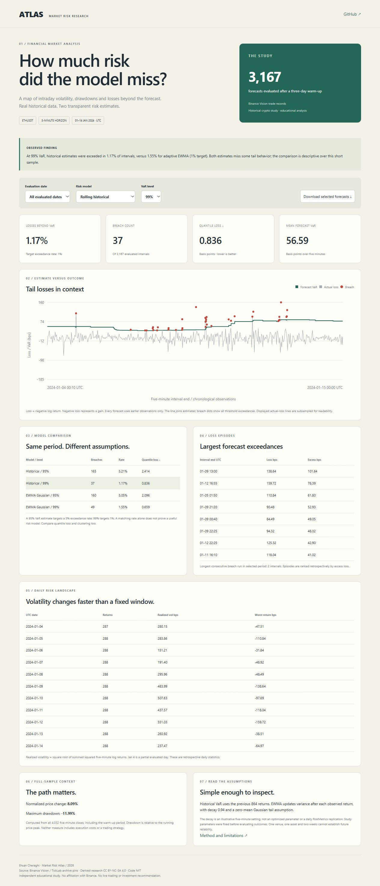

# Market Risk Atlas

An intraday financial-market analysis project comparing historical and adaptive downside-risk estimates on real ETHUSDT trade records.

**[Open the interactive report](https://ehsan-ch.github.io/market-risk-atlas/)** · [Research method](RESEARCH.md) · [Source pins](data/source_manifest.json)



## Observed results

The study aggregates **11,075,805 Binance Vision trade records** into 4,032 five-minute closing prices. After 864 training returns, it evaluates **3,167 one-step forecasts**. All model settings were fixed before evaluating the sample.

| Model | VaR level | Exceedances | Observed rate | Target rate | Quantile loss (bps) ↓ |
|---|---:|---:|---:|---:|---:|
| Rolling historical | 95% | 165 | 5.21% | 5% | 2.414 |
| EWMA Gaussian | 95% | 160 | 5.05% | 5% | 2.096 |
| Rolling historical | 99% | 37 | 1.17% | 1% | 0.836 |
| EWMA Gaussian | 99% | 49 | 1.55% | 1% | 0.659 |

EWMA has lower quantile loss but more 99% exceedances. A rate closer to target does not necessarily imply a better quantile forecast. Full-period maximum drawdown is approximately **−11.99%**, measured from the sampled five-minute closes. This is a descriptive two-week, single-asset study; it does not establish future reliability or trading performance.

## Inspect without downloading source archives

Requires Python3.11/3.12 and Node22 or later:

```sh
python -m pip install -r requirements.txt
python -m unittest discover -s tests -p "test_*.py"
python verify.py
npm test
npm start
```

Open http://127.0.0.1:8798/. No Node dependencies or API keys are needed. Choose a date, risk model and confidence level; inspect the threshold chart, breach episodes and daily realized volatility; export the selected forecasts.

## Rebuild the study

```sh
python download.py
python build.py
python verify.py
```

`download.py` downloads the fixed fourteen daily archives (about160MB compressed), checks publisher SHA256 and pinned manifest hashes, and stops on source revisions. Raw files live under ignored `data/raw/`. If already downloaded elsewhere:

```sh
python build.py --raw-dir /absolute/path/to/archives
```

The original run reused the locally cached, hash-verified TickLab archives. `ingest.py` adapts its MIT-licensed validation/aggregation code. Source archives are streamed; no raw trade files are redistributed. The generated `report.json` contains normalized price context, returns and derived risk estimates. `forecasts.csv` supplies all evaluated forecast/outcome pairs. The full report and static interface are served from the repository root on GitHub Pages.

## Key decisions

- Non-overlapping five-minute log returns in basis points, continuous across UTC days.
- First864 returns warm up both methods; no first return is invented before the first available closing price.
- Historical VaR: empirical quantile of the preceding864 losses, with linear interpolation.
- Adaptive VaR: zero-mean Gaussian tail using EWMA variance with fixed decay0.94. Variance updates only after the target return is observed.
- Both methods forecast exactly the same intervals. Strict exceedance means loss > VaR; a value equal to the threshold is not a breach.
- Full-sample return/drawdown include training observations; model evaluation excludes them. Jan4 has287 evaluated returns; later days have288 each.

## Files and checks

`config.json` locks the protocol. `build.py` generates results; `risk.py` contains estimators and scoring. `verify.py` reconciles all exported rows, summary statistics, daily realized volatility and protocol/source-manifest hashes. Ten Python tests validate causality, estimator updates, scoring and drawdowns; four JavaScript tests reconcile browser calculations and exports with the Python report. GitHub Actions runs both Python versions and Node22. CI verifies saved results without redownloading all archives.

## Licensing

Code: MIT (`LICENSE`). Source data and derived research artifacts (`report.json`, `forecasts.csv`, figures and data-backed analysis) are **CC BY-NC-SA4.0** with attribution to Binance Vision and Ehsan Cheraghi / TickLab. See [DATA_LICENSE.md](DATA_LICENSE.md). Independent educational work; no Binance affiliation, live trading or investment recommendation.
